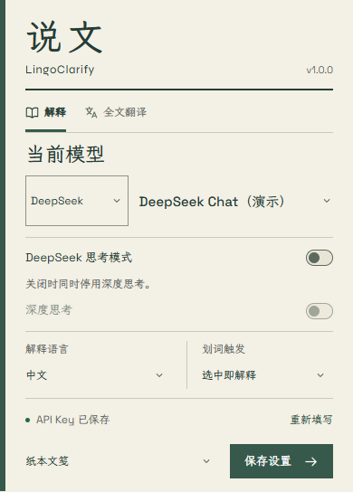
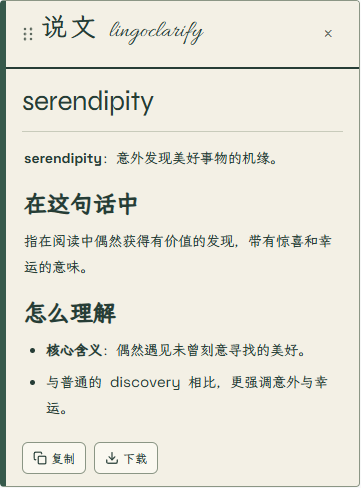

<p align="center">
  
</p>

# 说文 · LingoClarify

**选中即读懂，整页也能译。**

说文是一款使用自备 API Key 的浏览器扩展，支持网页划词翻译、语境解释与全文翻译。选中词语、句子或其他内容，在当前页面阅读回答；遇到整页外语，也可以开启全文翻译并随时切回原文。

**当前版本：1.0.0** · 原生 Manifest V3 · 无需构建 · 已在 Microsoft Edge 中验收

[安装与配置](#安装与配置) · [使用方法](#使用方法) · [接口与模型](#接口与模型) · [常见问题](#常见问题) · [开发说明](docs/DEVELOPMENT.md)

## 能做什么

| 功能 | 使用体验 |
| --- | --- |
| 划词翻译与语境解释 | 解释词义、概念和句意，也能结合选区处理代码、公式、表格与不完整片段 |
| 全文翻译 | 翻译视口附近和滚动出现的文字，响应动态内容，支持原文/译文切换与取消 |
| 可拖动的流式浮层 | 回答逐帧显示，完成后排版为 Markdown；可拖到合适位置阅读 |
| 复制与笔记下载 | 复制完整 Markdown 原文，或下载包含所选原文和回答的 TXT |
| 两套独立用途配置 | 解释与翻译可分别选择厂家、模型、语言及思考设置 |
| 自定义兼容接口 | 连接支持所需协议的第三方网关、聚合服务或本机服务 |
| 三种阅读配色 | 纸本文笺（默认）、清浅青、冷灰蓝，设置页、结果浮层与全文工具栏同步切换 |

默认的**纸本文笺**采用米白纸色与墨绿文字，扩展图标也使用相同配色。中文使用本地霞鹜文楷屏幕阅读版，英文正文与标题使用 Space Grotesk / Syne，浮层英文字标使用 Allura 连笔手写体；字体随扩展打包，无需访问字体 CDN。

## 界面预览

### 设置页



### 划词结果



截图来自隔离 Edge 中实际加载的扩展，使用合成配置、网页与本机模拟回答。设置页截图展示扩展页面内容，不是原生工具栏弹出窗口；截图不代表真实模型质量或速度。来源见[公开材料说明](docs/materials/README.md)。

## 安装与配置

### 1. 获取源码

[下载 main 分支 ZIP](https://github.com/siwenyu1213/LingoClarify/archive/refs/heads/main.zip)，解压后保留完整文件夹；也可以使用 Git：

```bash
git clone https://github.com/siwenyu1213/LingoClarify.git
```

### 2. 在 Edge 中加载

1. 打开 `edge://extensions`，开启**开发人员模式**。
2. 点击**加载解压缩的扩展**，选择包含 `manifest.json` 的项目根目录。
3. 将“说文 · LingoClarify”固定到工具栏，点击图标打开设置。

根目录可直接加载，无需安装 npm 依赖或执行构建命令。其他浏览器需另行验收。

### 3. 配置模型服务

需要所选服务的 API Key，以及兼容的模型列表和流式生成接口。扩展本身不提供免费模型额度；调用费用、权限和额度由所选服务决定。

1. 在**解释**标签选择模型厂家。使用自定义服务时，先通过**配置自定义接口**保存地址。
2. 填写 Key，点击**保存 API Key**，等待接口模型列表加载，然后选择模型与解释语言。
3. 在**全文翻译**标签配置翻译用途的厂家、模型与目标语言。
4. 选择**选中即解释**或**仅右键菜单**，点击**保存设置**。
5. 打开普通 HTTP/HTTPS 网页，选中文字开始使用。

两个用途选择同一家时共用该厂家的连接；选择不同厂家时，各自使用对应的 Key。模型下拉列表支持搜索和键盘选择。底部配色选择后自动保存，不需要额外点击保存按钮，也不会提交正在编辑的 Key、模型或语言草稿。

## 使用方法

### 划词翻译与解释

默认选中文字后自动弹出回答。也可以选中文字，再右键选择 **“📖 说文：解释选中文字”**。设为“仅右键菜单”后，选中文字不会自动发起请求，右键入口继续可用。

| 选中的内容 | 处理方式 |
| --- | --- |
| 外语词语、短语与短片段 | 先给中文含义或译文，再解释词义、概念和必要的语境差异 |
| 外语完整句子或段落 | 使用翻译配置给出目标语言译文，必要时补充文中含义；完成后可点击“解释此句” |
| 中文词语、名称或句段 | 解释概念、整体意思与关键关系 |
| 代码、公式、指标、表格或不完整片段 | 使用解释配置，结合选区结构和必要材料处理 |

扩展先在本地判断选区类型，再发送一次生成请求。分类规则并非完整语言识别器，实际回答取决于模型与提供的材料。

- **移动浮层**：在顶部按住鼠标左键拖动。拖动后的位置在流式更新和页面滚动时保留；重新划词后恢复自动定位。
- **关闭浮层**：点击外部、关闭按钮，或按 `Esc`。
- **阅读回答**：流式阶段逐帧显示 Markdown 原文，可能暂时看到 `**`、`#` 等标记；队列播放完成后统一安全排版，支持标题、强调、列表、引用、代码、表格和链接。长代码与表格可以横向滚动。
- **复制或保存**：正文与思考都播放完成后显示操作按钮。复制保留 Markdown 原文；下载保存为 `笔记/说文_时间戳.txt`，包含所选原文和完整回答。“已开始下载”表示浏览器已接受任务，最终状态以下载管理器为准。

浮层会尝试避开原文，空间不足时限制高度并在内部滚动。回答优先给出核心译文、定义或结论，必要时使用小标题、列表或概念例子；实际格式由模型决定。

### 全文翻译

在普通网页空白处右键选择 **“🌐 说文：全文翻译”**。

页面顶部中央显示进度栏，可切换原文/译文或取消。栏下方的**方框箭头**用于收起或展开整条进度栏；隐藏后翻译继续运行，展开时显示最新进度。隐藏时再次通过右键启动全文翻译，也会打开当前进度栏。

翻译覆盖视口附近、滚动出现和动态新增的文字，按原有文本节点写入，保留链接、图片与强调结构。取消时恢复仍由扩展写入的文字，尽量保留网页自身的更新。每次新任务默认展开进度栏。

可编辑区域、代码和标记为禁止翻译的区域会跳过。复杂页面、行内标签切分和网页自身更新仍可能影响翻译质量或布局；全文翻译只写入译文，不附加解释。

## 接口与模型

设置页提供 OpenAI、DeepSeek、Anthropic、Google、阿里千问、月之暗面、智谱、MiniMax、xAI、Mistral AI 的地址预设，以及**自定义接口**。

地址预设不等于该厂家全部原生协议或所有模型均已兼容。所选服务需要支持以下请求；只提供其他原生协议的服务需通过兼容网关接入。

| 用途 | 协议要求 |
| --- | --- |
| 鉴权 | `Authorization: Bearer <API Key>` |
| 模型列表 | `GET <Base URL>/models`，返回兼容的 `data` 列表 |
| 生成 | `POST <Base URL>/chat/completions` |
| 流式正文 | OpenAI 格式 SSE，正文位于 `choices[0].delta.content` |

模型选项来自所选接口返回的文本型号，完整模型 ID 自动保存。已有列表可在查询失败时保留；没有兼容模型列表且没有可用缓存时，无法新选模型。列表查询成功也不保证拥有生成权限。当前不支持仅有 Responses API 的服务或特殊鉴权协议。

自定义接口需要明确保存地址，支持 Base URL 或完整的 `/chat/completions` 地址。缺少地址时不发送请求；更改地址后需重新加载列表、选择模型并保存。其他地域或网关地址也通过自定义接口配置。

### DeepSeek 思考设置

当实际接口主机为 `api.deepseek.com` 时，解释和翻译各自提供**DeepSeek 思考模式**开关，默认关闭。打开后允许模型思考；关闭后显式发送关闭参数，同时取消并禁用深度思考，不发送思考强度。

总开关打开后，可进一步启用**深度思考**并选择强度。关闭再打开总开关不会自动恢复深度思考。配置保存后用于划词、再次解释、全文与批量翻译；第三方网关不会仅凭模型名套用 DeepSeek 专用参数。其他兼容接口开启深度思考时发送 `reasoning_effort`，关闭时省略该参数。

## 数据与隐私

完整说明见 [隐私政策](PRIVACY.md)（更新于 2026-10-16）。

- API Key 和设置保存在浏览器扩展的 `chrome.storage.local` 中，扩展未额外加密 Key；输入框收起只是界面处理。Key 在查询模型或生成时发送给对应接口。
- 默认“选中即解释”会自动发送选区及必要材料，可改为“仅右键菜单”。材料可包含所在句、邻近文字、结构信息和页面标题；全文翻译发送待翻译文字，批量任务可使用页面标题。当前生成提示词不主动加入网页地址字段，原文中已有的网址仍可能发送。
- 打开设置页会刷新 OpenRouter 公开模型目录，即使生成使用其他厂家；此目录请求不附加你的 Key 或网页内容，但接收方可能获得 IP 等常规网络信息。
- 全文翻译启动后会继续处理滚动附近及动态文字；切回原文或收起进度栏不停止任务，点击“取消”才停止。已发送内容无法撤回。
- Markdown 解析与清理由扩展随附的本地库完成。远程图片不会自动加载，HTML 不作为网页代码执行，只有 HTTP/HTTPS 链接可点击。
- 扩展没有对话云同步、广告追踪或开发者托管的生成服务；模型服务和网关的留存、训练及处理地域由各服务规则决定。自定义 HTTP 地址不提供传输加密，远程调用请使用可信 HTTPS 接口。

## 常见问题

更新源码后，在 `edge://extensions` 点击**重新加载**，并刷新已打开的网页。已有厂家、Key、模型和主题配置可继续使用。

| 情况 | 处理方法 |
| --- | --- |
| 提示扩展已重载 | 刷新当前网页后重新划词 |
| 模型列表为空、Key 无效或查询失败 | 核对厂家、Key、权限、网络和 `/models` 兼容性 |
| 自定义接口提示缺少地址 | 先打开“配置自定义接口”保存服务商地址 |
| 模型不支持思考参数 | 关闭该用途的深度思考后重试 |
| 设置页显示“扩展当前已停用” | 点击“启用扩展”，然后刷新网页 |
| 浮层遮挡原文 | 按住顶部拖动；选区占满视口时无法保证完全避让 |
| 回答先显示 Markdown 标记 | 属于逐帧播放过程，播放结束后会排版 |
| 下载失败 | 重试下载，并检查浏览器下载管理器 |
| 内部页面或商店页没有反应 | 浏览器对这些页面有限制，请在普通 HTTP/HTTPS 网页使用 |

当前没有代码语法高亮、LaTeX 公式或 Mermaid 图渲染。Chrome 及其他浏览器、真实供应商生成质量与速度需单独验收。

## 开发与验证

项目使用原生 JavaScript、HTML、CSS，根目录直接作为扩展加载；本地第三方库与字体保存在 `vendor/`，可复用验证工具位于 `scripts/`。

```powershell
node scripts/verify.mjs --report artifacts/qa/static-check.json
node scripts/verify-api.mjs
git diff --check
```

静态检查验证语法、MV3 基本入口、本地资源与版本一致性；后台模拟检查配置、路由、流式响应与失败处理。它们不能替代实际浏览器交互或有效凭据的供应商验收。浏览器验证使用隔离 Edge、合成页面/Key 和本机接口，详细范围与证据见[开发与验收说明](docs/DEVELOPMENT.md)。

| 模块 | 职责 |
| --- | --- |
| `manifest.json` | 扩展入口、权限、内容注入、版本与图标 |
| `background.js` | 消息、右键菜单、API 代理、流式响应、缓存与下载 |
| `content.js` / `content.css` / `markdown.js` | 划词浮层、拖动、逐帧播放与安全 Markdown 排版 |
| `content-fullpage.js` | 按需注入的全文翻译、动态内容、切换与取消 |
| `popup.*` / `select-menu.js` | 设置界面、Key/模型配置与自绘菜单 |
| `config.js` / `model-catalog.js` | 连接配置、迁移、目录与接口模型查询 |
| `selection.js` / `selection-prompts.js` | 选区分析、上下文提取与提示词构建 |
| `theme.js` / `theme.css` / `icons/` | 配色同步、本地字体与品牌资源 |

仓库只上传运行源码、资源与许可证、使用/开发说明、可复用工具和公开材料。私有网页、Key、浏览器配置、逐次任务记录及生成报告仅保存在本地。

- [项目工作规则](AGENTS.md)
- [第三方库来源与许可证](vendor/README.md)
- [本地字体来源与 OFL 许可](vendor/fonts/README.md)
- [公开截图来源](docs/materials/README.md)
